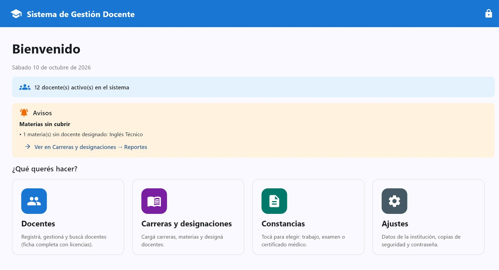
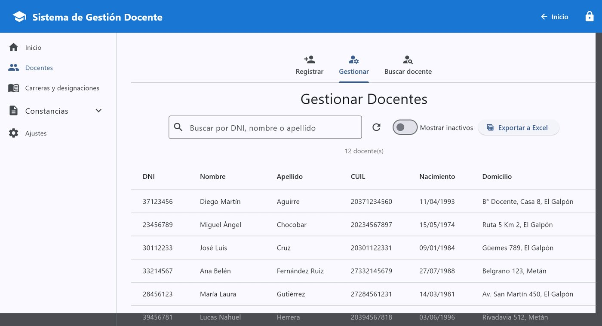
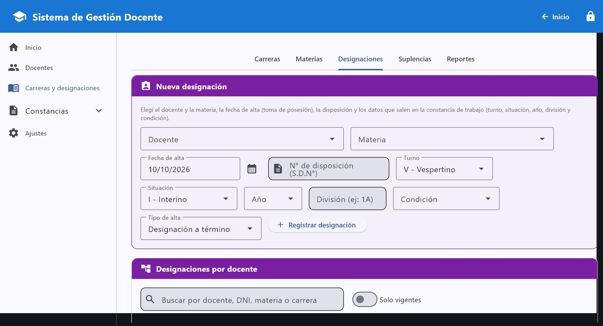
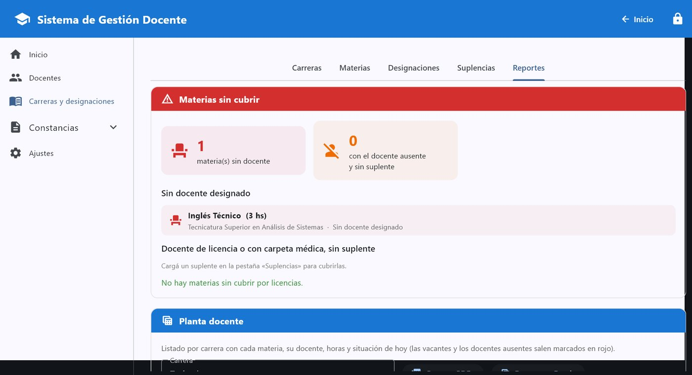

# Sistema de Gestión Docente

Aplicación de escritorio para administrar el personal docente de un instituto de nivel superior. Desarrollada en Python con [Flet](https://flet.dev/) como proyecto de la carrera, y usada como programa para Windows.



## Funcionalidades

- **Docentes:** alta, edición, baja lógica y búsqueda por DNI, nombre o apellido. Importación desde Excel con una plantilla descargable y exportación del listado.
- **Carreras, materias y designaciones:** carga de la estructura académica y asignación de docentes a cada materia, con turno, situación, condición y tipo de alta.
- **Licencias y suplencias:** registro de licencias y carpetas médicas, y asignación de suplentes.
- **Reportes:** materias sin docente designado, docentes ausentes sin suplente y planta docente por carrera.
- **Constancias en PDF:** constancia de trabajo, de mesa de examen y de certificado médico, con los datos de la institución configurables.
- **Seguridad:** acceso con contraseña (se guarda solo un hash PBKDF2 con sal) y copias de seguridad automáticas de la base de datos.
- **Validaciones:** DNI, CUIL, fechas y email, con pruebas unitarias.

## Tecnologías

- Python 3
- Flet (interfaz gráfica)
- SQLite
- ReportLab (PDF) y openpyxl (Excel)
- unittest
- PyInstaller (ejecutable para Windows)

## Capturas

| Gestión de docentes | Designaciones | Reportes |
|---|---|---|
|  |  |  |

Las capturas usan datos de prueba.

## Cómo ejecutarlo

```bash
pip install -r requirements.txt
python main.py
```

La primera vez que se abre, el sistema pide crear una contraseña y genera la base de datos `Gestion.db`. Si se olvida la contraseña, con el sistema cerrado se ejecuta `python restablecer_clave.py`.

Para correr las pruebas:

```bash
python -m unittest discover -s tests
```

## Estructura

```
├── main.py            # Punto de entrada
├── ui.py              # Navegación y pantallas principales
├── config.py          # Configuración y datos por defecto de la institución
├── database/          # Conexión, consultas, ajustes y contraseña
├── crud/              # Lógica de docentes, carreras, suplencias y validaciones
├── certificados/      # Generación de constancias en PDF
├── herramientas/      # Importar/exportar Excel, copias de seguridad, ajustes
└── tests/             # Pruebas unitarias
```

## Autor

Miguel Alesandro Villalba · [Portfolio](https://alesandrovi.github.io/portafolio/) · [LinkedIn](https://www.linkedin.com/in/alesandro-villalba-bb6508367)
